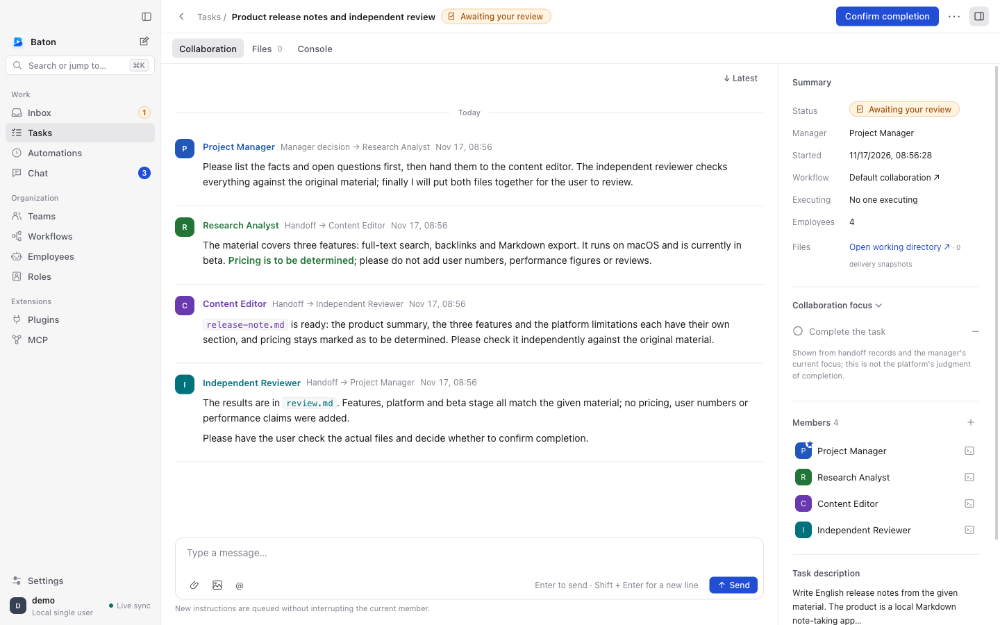
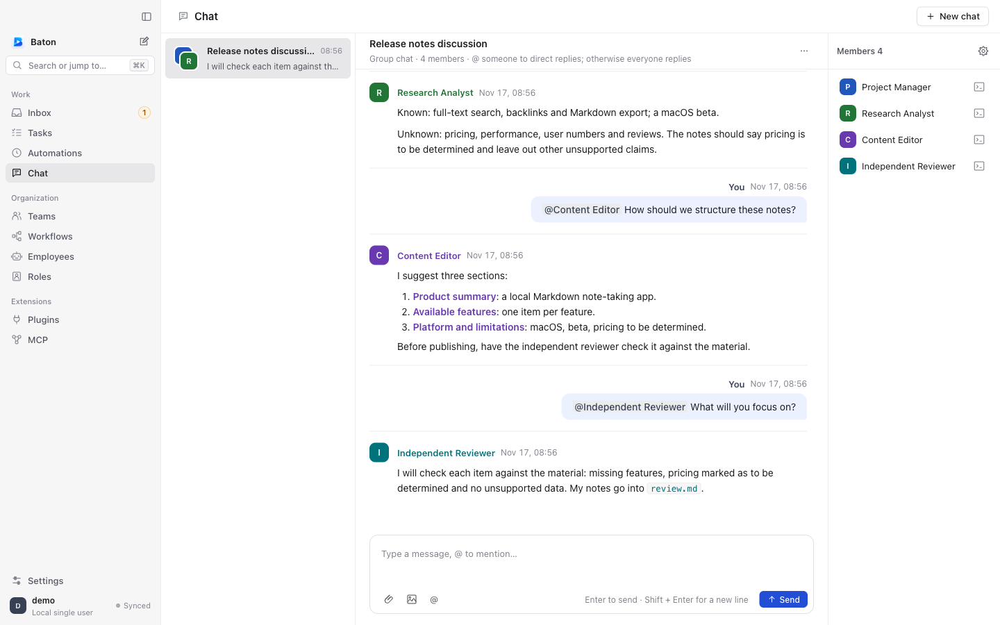
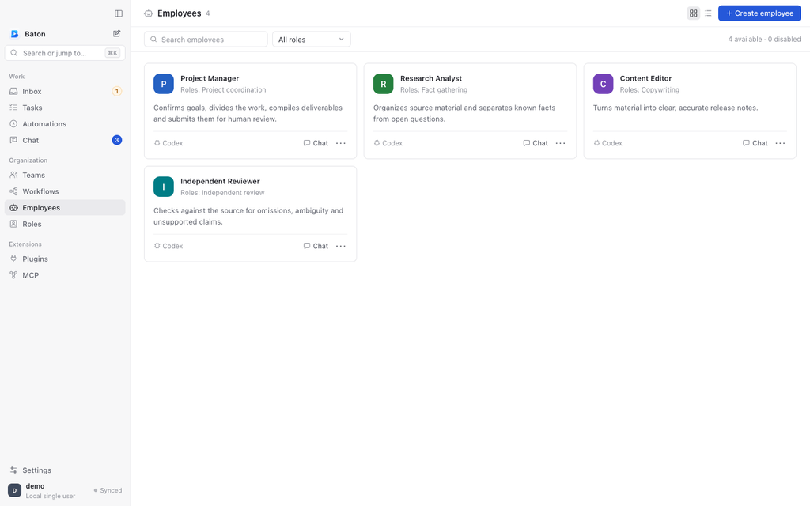
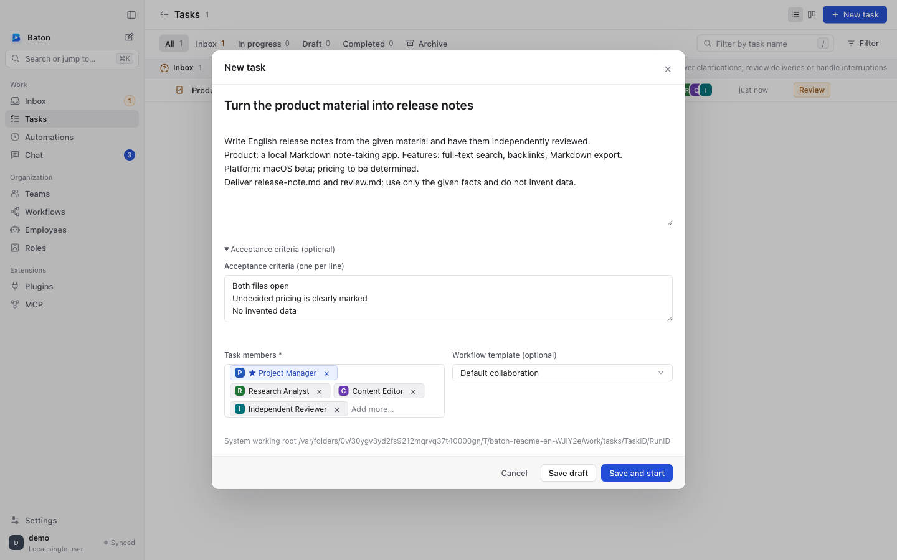
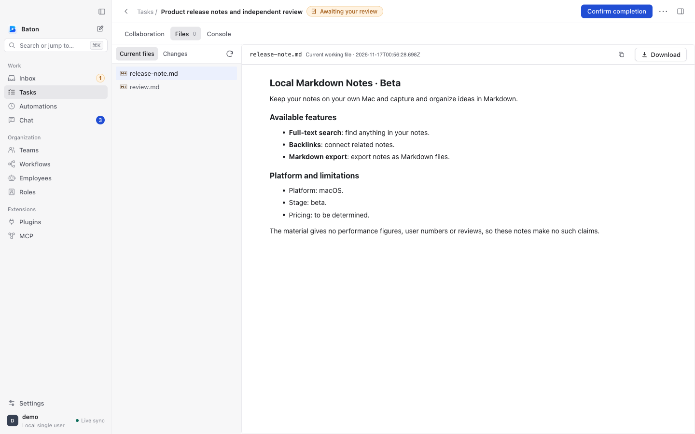

<div align="center">
  
  <h1>Baton · AI Team OS</h1>
  <p><strong>An AI team operating system for one-person companies: configure agents like custom virtual employees, organize multi-agent groups or teams, and collaborate to deliver real files.</strong></p>
  <p>You own the goals and decisions; your AI employees each do their part.</p>
  <p>Claude Code · Codex · DeepSeek Harness · Cursor · Gemini CLI · Qwen Code · Kimi Code · Pi · OpenCode</p>
  <p><a href="https://github.com/dengdai68/Baton/releases/latest">Download for macOS</a> · <a href="#quick-start">Quick start</a> · <a href="#cli">CLI</a> · <a href="docs/README.md">Docs (Chinese)</a> · <a href="https://github.com/dengdai68/Baton/issues">Feedback</a> · <a href="README.md">简体中文</a></p>
</div>

From software development, research and analysis to knowledge work and content production, you can define each agent's responsibilities, prompt, model and tools, talk with a single virtual employee, or form a team to carry out tasks together. Baton keeps members, collaboration, execution records and delivered files in one local workspace.

[](docs/media/workspace-collaboration.en.png)

*Task workspace: follow assignments, handoffs and human review in one place. Screenshots and the animation show the English interface in an isolated instance with public sample data and no model calls; click a screenshot to see the full image.*

## What it does

| Capability | How to use it |
| --- | --- |
| Custom virtual employees | Configure responsibilities, system prompts, shared runtimes and tools; choose models and thinking levels centrally in runtime settings, and reuse prompts, plugins and MCP through roles. |
| AI teams | Save frequently used teams or pick members across teams; the manager coordinates the work while different employees execute in parallel, each keeping its own session. |
| Task center | Save a draft or start right away, search and filter progress, pause, resume, recover failed executions and archive; collaboration, console and files live in the same task. |
| Workflows | Use a flowchart to define responsibilities, condition branches, staffing, deliverables and handoffs as collaboration guidance for the manager. |
| Direct and group chats | Discuss requirements with employees, use @ to direct questions, upload images and files, add instructions or answer clarifications during collaboration; delete group chats you no longer need from the group settings. |
| Scheduled automations | Schedule recurring tasks with cron; each round's execution, trigger status and results are recorded separately. |
| Plugins, skills and MCP | Install plugins, load skills and choose MCP servers for employees; view tool lists and input/output schemas and check runtime compatibility. |
| Files and console | Preview and download the real files in the working directory and review cumulative changes and diffs; the console appends execution records incrementally and expands bodies on demand. |
| Interface language | Simplified Chinese, Traditional Chinese and English. Follows the macOS language by default; switch in “Settings → General → Language”. Business content, prompts, CLI output and history stay as written. |

| Employees | Team chat |
| :---: | :---: |
| [](docs/media/employees.en.png) | [](docs/media/team-chat.en.png) |
| Assign responsibilities and reuse roles and tool configuration. | Discuss requirements in direct or group chats and @ the members who should reply. |

## Quick start

**Create employees → create a task → follow assignments and handoffs in the collaboration record → check the files and confirm delivery.**



*A looping 15-second tour made from real app screenshots to show where things are.*

1. In “Settings → Runtime”, check the native CLIs that are installed and signed in, then create an employee, fill in its responsibilities and choose a runtime.
2. In “Tasks → New task”, enter the goal, add teams or employees, and click a selected member to make them the manager for this task; the workflow and acceptance criteria are optional.
3. Choose “Save draft” to keep it for later, or “Save and start” to call the models. Follow assignments, answer clarifications, @ members and add instructions under “Collaboration”; open a message's “This turn's console” when you need the details.
4. Check the real results in the working directory under “Files”. After a regular task is submitted for review, you confirm completion in the app.

| Create a task | Check the real files |
| :---: | :---: |
| [](docs/media/task-create.en.png) | [](docs/media/workspace-files.en.png) |

Ready-to-copy employee prompts and task material are in the [first-use tutorial](docs/quickstart.md) (Chinese).

## CLI

`baton` uses the same authenticated HTTP interface as the desktop app, so terminals, scripts or other agents can manage the same configuration, tasks and chats. It offers step-by-step `--help`, field `schema` and explicit `--json` output. CLI output is in Simplified Chinese.

| Command group | Capabilities |
| --- | --- |
| `tasks` | Create and edit drafts, start and pause, resume and recover failures, collaboration and clarification, console, files and changes, archive. |
| `communications` | Long-term direct and group chats, messages and attachments, read state, failure retry and console. |
| `agents` / `roles` / `teams` | Manage employees, roles, teams and their related configuration. |
| `workflows` | Manage flowchart nodes, conditions, connections, staffing and deliverables. |
| `plugins` / `mcps` | Install and manage plugins and MCP; query compatibility, tool lists and schemas. |
| `automations` | Configure scheduled tasks, trigger them manually and query each round's results. |
| `runtimes` / `storage` / `auth` | Runtime configuration and connection checks, storage location and CLI sign-in status. |

Start and sign in to the app first; the CLI reuses the app's authorization by default. The installed app sets up the shell command automatically; if `baton` cannot be found, check and repair the installation in “Settings → CLI”.

```bash
baton --help
baton agents list
baton tasks create --help
baton schema tasks
baton tasks list --json
baton communications list
```

Creating a task saves a draft by default; add `--start` to call the models immediately. The CLI can query files, recover failed executions and take part in chats; final review of regular tasks stays in the app. Full fields, usage and failure handling are in the [CLI guide](docs/21-configuration-cli.md) (Chinese).

## Installation

The current installer supports **macOS 13+ on Apple Silicon (M series)**.

1. Download the DMG from [GitHub Releases](https://github.com/dengdai68/Baton/releases/latest) and drag **Baton** into **Applications**.
2. The current version is ad-hoc signed, without a Developer ID signature or Apple notarization. If macOS says it cannot verify the app or that the app is damaged, make sure the download source is trusted, then run in a terminal:

   ```bash
   sudo xattr -dr com.apple.quarantine "/Applications/Baton.app"
   ```

   This only removes the quarantine attribute from this app; then open the app again.
3. On first launch, create the local administrator and check the runtimes and working directory in Settings. Install and sign in to at least one supported native CLI (such as **Claude Code, Codex, OpenCode**) beforehand, and you can configure employees and get started.

The app ships its own local service; no server deployment is needed. The software is open source under Apache-2.0; model subscriptions, APIs and third-party tools are paid separately. It is currently a local single-administrator app: employees run with the current system user's permissions and there is no agent sandbox, and model calls still connect to their services. There are no Intel Mac, Windows or Linux installers yet.

## Run from source

Requires **Node.js 22.12+ (Node 24 recommended)**, npm and Git:

```bash
git clone https://github.com/dengdai68/Baton.git
cd Baton
npm ci
npm start
```

`npm start` launches Electron with its own random-port backend; `npm run dev` uses the same entry. Use `node cli/main.mjs --help` for the CLI from source. See [CONTRIBUTING](CONTRIBUTING.md) for more on development and builds.

Interface text lives in `client/locales/` (`en.json`, `zh-TW.json`), keyed by the Simplified Chinese source text; `npm test` checks that every interface string has both translations.

---

[Documentation (Chinese)](docs/README.md) · [Changelog](CHANGELOG.md) · [Apache-2.0](LICENSE) · [Third-party notices](NOTICE)
