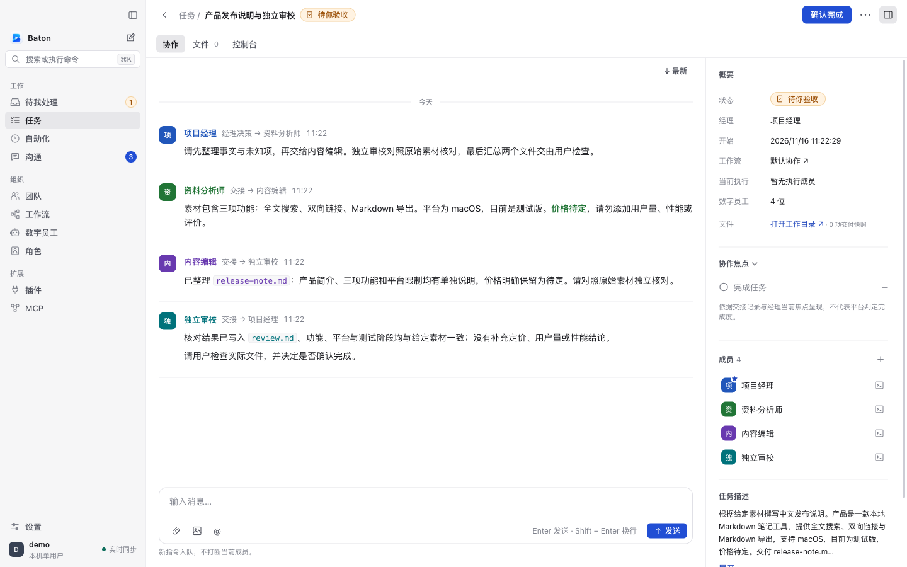
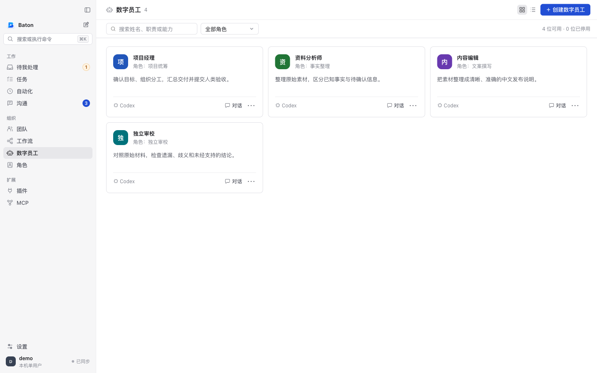
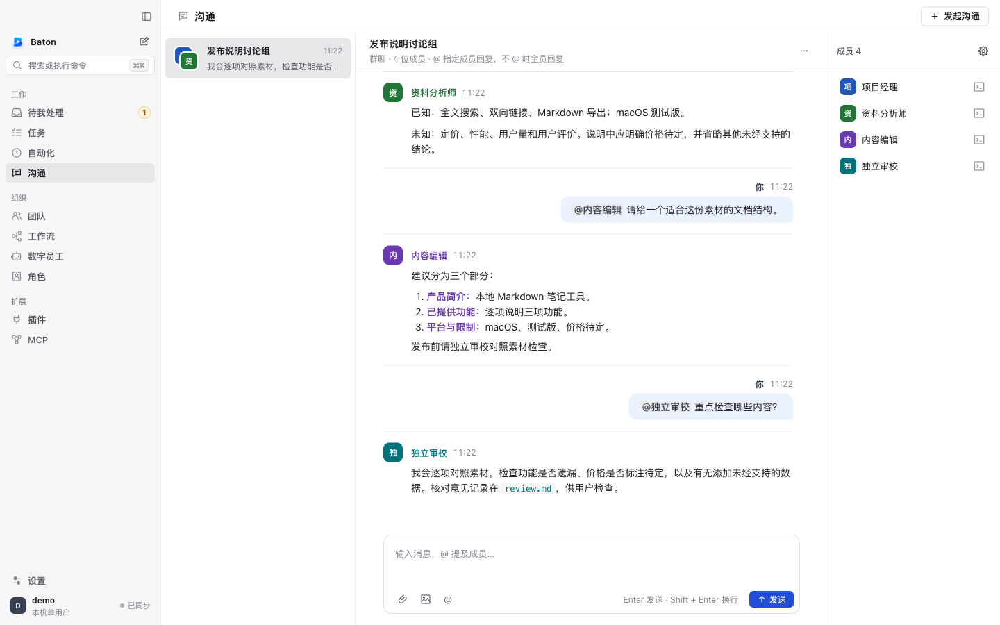
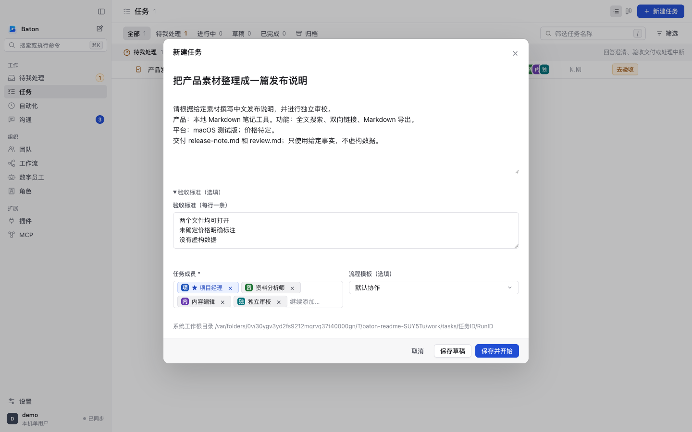
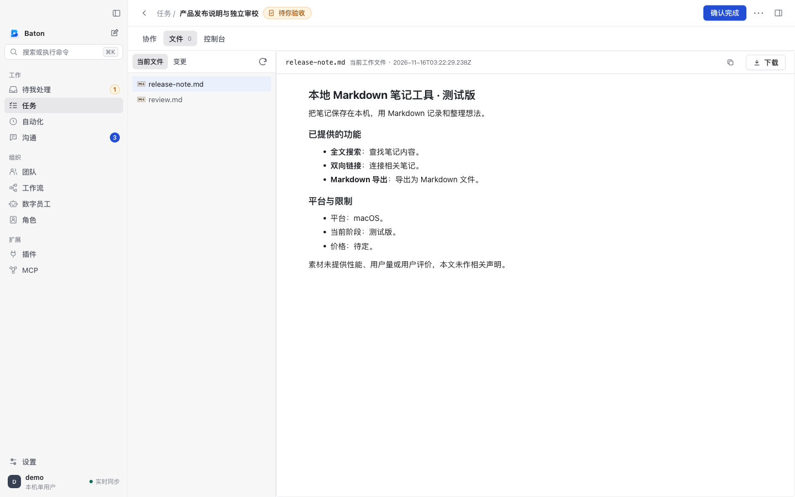

<div align="center">
  
  <h1>Baton · AI Team OS</h1>
  <p><strong>面向超级个体的 AI 团队操作系统：像定制虚拟员工一样配置 Agent，组织多 Agent 小组或团队，协作完成任务并交付真实文件。</strong></p>
  <p>你负责目标与决策，让 AI 员工各司其职。</p>
  <p>Claude Code · Codex · DeepSeek Harness · Cursor · Gemini CLI · Qwen Code · Kimi Code · Pi · OpenCode</p>
  <p><a href="https://github.com/dengdai68/Baton/releases/latest">下载 macOS 版</a> · <a href="#快速上手">快速上手</a> · <a href="#cli">CLI</a> · <a href="docs/README.md">文档</a> · <a href="https://github.com/dengdai68/Baton/issues">反馈</a> · <a href="README.en.md">English</a></p>
</div>

从代码开发、调研分析到知识整理和内容生产，你可以为 Agent 定义职责、提示词、模型与工具，与单个虚拟员工交流，也可以组建团队共同执行任务。Baton 将成员、协作、执行记录和交付文件组织在同一个本机工作空间中。

[](docs/media/workspace-collaboration.png)

*任务工作空间：在同一处跟进分工、交接与人类验收。本文截图与动图来自 v0.1.10 隔离实例，使用公开示例数据，未调用模型；点击截图可查看原图。*

## 能做什么

| 能力 | 用法 |
| --- | --- |
| 定制虚拟员工 | 配置职责、系统提示词、共享 Runtime 与工具；在 Runtime 设置中统一选择模型和思考等级，用角色复用提示词、插件与 MCP。 |
| 组织 AI 团队 | 保存常用团队，也可跨团队挑选成员；经理协调分工，不同员工并行执行、独立保留会话。 |
| 任务中心 | 创建草稿或直接启动，搜索与筛选进展，暂停、继续、恢复失败执行与归档，在同一任务里查看协作、控制台和文件。 |
| 工作流 | 用流程图定义职责、条件分支、人员需求、交付要求和交接关系，为经理提供协作指引。 |
| 私聊与群聊 | 与员工讨论需求，通过 @ 定向交流，上传图片和文件，在协作中补充指令或回答澄清；不再需要的群聊可在群聊设置中删除。 |
| 定时自动化 | 用 Cron 安排重复任务，独立记录每轮执行、触发状态和成果。 |
| 插件、Skill 与 MCP | 安装插件、加载 Skill，为员工选择 MCP；查看工具列表和输入输出 schema，核对 Runtime 兼容性。 |
| 文件与控制台 | 预览、下载工作目录中的实际文件，查看累计变更与差异；控制台增量追加执行记录，按需展开正文。 |
| 多语言界面 | 支持简体中文、繁體中文与 English；默认跟随 macOS 语言，可在「设置 → 常规 → 语言」切换。业务内容、提示词、CLI 输出与历史记录保持原文。 |

| 数字员工 | 团队沟通 |
| :---: | :---: |
| [](docs/media/employees.png) | [](docs/media/team-chat.png) |
| 为成员分配职责，复用角色与工具配置。 | 私聊或群聊讨论需求，通过 @ 指定回复成员。 |

## 快速上手

**定制员工 → 创建任务 → 在协作记录跟进分工与交接 → 检查文件并确认交付。**


*约 15 秒的循环界面导览；由实际客户端截图组成，用于说明操作入口。*

1. 在「设置 → Runtime」检查已安装并授权的原生 CLI，再创建数字员工，填写职责并选择 Runtime。
2. 在「任务 → 新建任务」填写目标，添加团队或员工，点击已选成员指定一位本次经理；工作流和验收标准选填。
3. 选择「保存草稿」暂存，或「保存并开始」调用模型。在「协作」跟进分工、回答澄清、@ 成员和补充指令，需要细查时打开相应消息的「本轮控制台」。
4. 在「文件」检查工作目录中的实际成果。普通任务提交验收后，由你在客户端确认完成。

| 创建任务 | 检查实际文件 |
| :---: | :---: |
| [](docs/media/task-create.png) | [](docs/media/workspace-files.png) |

可直接复制的员工提示词与任务素材见[第一次使用教程](docs/quickstart.md)。

## CLI

`baton` 与桌面共用受认证的 HTTP 接口，可在终端、脚本或其他 Agent 中管理同一套配置、任务与沟通。支持逐级 `--help`、字段 `schema` 和显式 `--json` 输出。

| 命令组 | 能力 |
| --- | --- |
| `tasks` | 创建与编辑草稿、启动与暂停、继续与失败恢复、协作与澄清、控制台、文件和变更、归档。 |
| `communications` | 长期私聊与群聊、消息与附件、已读、失败重试和控制台。 |
| `agents` / `roles` / `teams` | 管理员工、角色、团队及其关联配置。 |
| `workflows` | 管理流程图节点、条件、连线、人员需求与交付要求。 |
| `plugins` / `mcps` | 安装与管理插件和 MCP，查询兼容性、工具列表与 schema。 |
| `automations` | 配置定时任务、手动触发、查询各轮触发结果。 |
| `runtimes` / `storage` / `auth` | Runtime 配置与连接检查、存储位置和 CLI 登录状态。 |

先启动并登录客户端，CLI 默认复用客户端授权。安装版自动安装 Shell 命令；找不到 `baton` 时，在「设置 → CLI」检查并修复安装。

```bash
baton --help
baton agents list
baton tasks create --help
baton schema tasks
baton tasks list --json
baton communications list
```

创建任务默认保存草稿，加 `--start` 才会立即调用模型。CLI 可查询文件、恢复失败执行和参与沟通；普通任务最终验收保留在客户端。完整字段、用法与失败处理见 [CLI 指南](docs/21-configuration-cli.md)。

## 安装

当前安装包支持 **macOS 13+ / Apple Silicon（M 系列）**。

1. 从 [GitHub Releases](https://github.com/dengdai68/Baton/releases/latest) 下载 DMG，将 **Baton** 拖入 **Applications**。
2. 当前版本采用 ad-hoc 签名，尚无 Developer ID 签名和 Apple 公证。如果 macOS 提示无法验证或应用已损坏，确认下载来源可信后，在终端执行：

   ```bash
   sudo xattr -dr com.apple.quarantine "/Applications/Baton.app"
   ```

   此命令只移除该应用的隔离属性，随后重新打开应用。
3. 首次打开创建本机管理员，在设置中检查 Runtime 和工作目录。提前安装并授权至少一种支持的原生 CLI（如 **Claude Code、Codex、OpenCode**），即可配置员工并开始使用。

应用自带本机服务，无需部署服务器。软件按 Apache-2.0 开源，模型订阅、API 和第三方工具费用另计。目前为本机单管理员应用，员工以当前系统用户权限执行，不提供 Agent 沙箱；模型调用仍会连接对应服务。尚无 Intel Mac、Windows 或 Linux 安装包。

## 从源码启动

需要 **Node.js 22.12+（推荐 Node 24）**、npm 和 Git：

```bash
git clone https://github.com/dengdai68/Baton.git
cd Baton
npm ci
npm start
```

`npm start` 启动 Electron 及其自有随机端口后台；`npm run dev` 使用相同入口。源码 CLI 使用 `node cli/main.mjs --help`。更多开发与构建说明见 [CONTRIBUTING](CONTRIBUTING.md)。

界面文字的译文位于 `client/locales/`（`en.json`、`zh-TW.json`），以简体中文源文本为键；`npm test` 会检查每条界面文字都有英文和繁体译文，隔离实机验收见 `node scripts/test-i18n.mjs`。

---

[使用文档](docs/README.md) · [更新记录](CHANGELOG.md) · [Apache-2.0](LICENSE) · [第三方声明](NOTICE)
