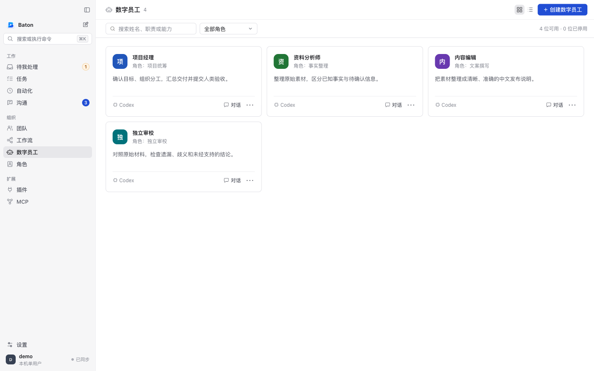
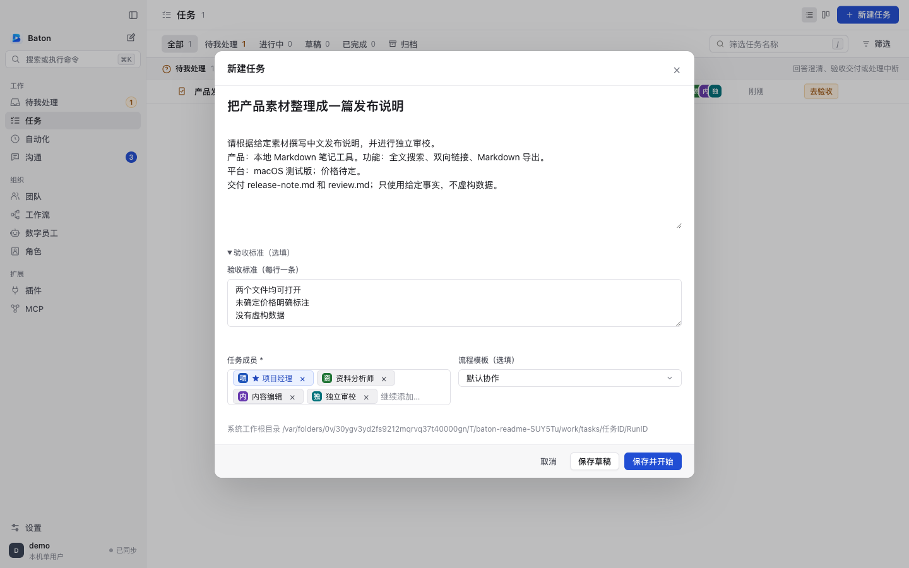
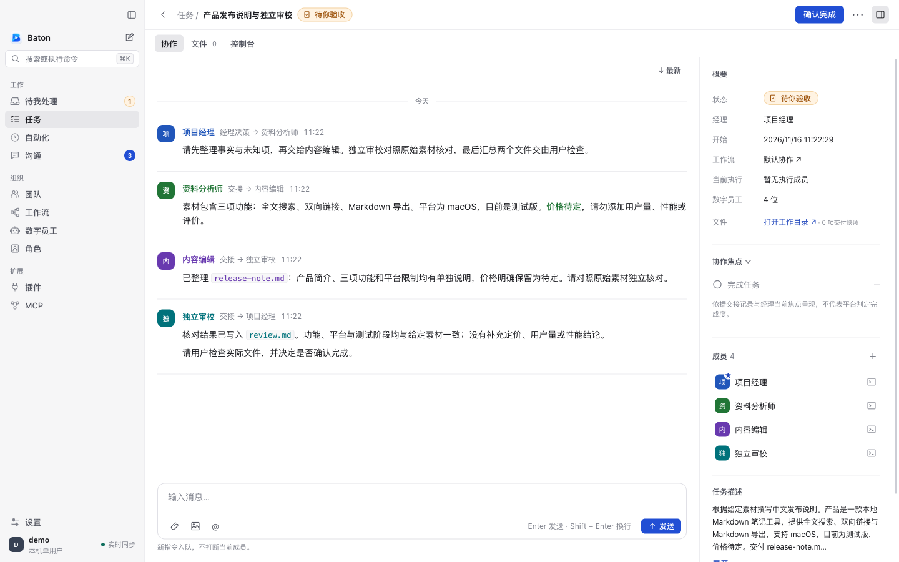
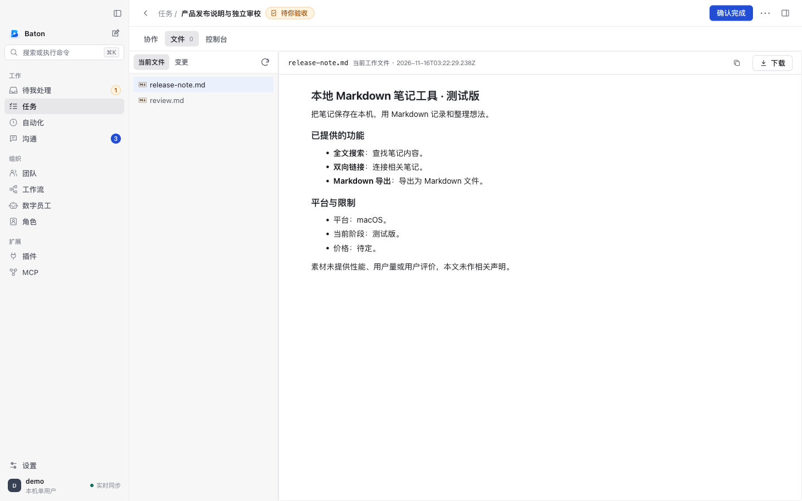

# 第一次使用：让 AI 团队把素材整理成发布说明

这篇教程面向已经使用 Claude Code、Codex 等原生 AI CLI 的开发者。先用一份自带素材的小任务熟悉员工、协作和文件交付，流程不依赖外部仓库、插件或 MCP。

安装包支持 macOS 13+ / Apple Silicon。应用按 Apache-2.0 开源，模型订阅、API 和工具费用另计。请从[最新正式版](https://github.com/dengdai68/Baton/releases/latest)下载；本文截图来自 v0.1.10 的隔离实例，使用公开示例数据，未调用模型。

## 1. 安装与准备

1. 从上述 Release 下载 Apple Silicon 对应的 DMG，打开后将应用拖入 Applications。
2. 当前安装包采用 ad-hoc 签名，未经 Apple 公证。若被 macOS 拦截，确认下载来源后按对应 Release 或 [README 安装说明](../README.md#安装)操作。
3. 首次启动创建本机管理员。进入「设置 → Runtime」，检查至少一种本机 Runtime，选择模型与思考等级。对应 CLI 需要提前安装并完成自身登录或 API 配置；应用不提供模型账号或额度。
4. 确认任务工作根目录有写入权限。建议首次任务使用独立目录，不放入重要项目。

不需要部署 Web 服务器，也没有在线演示账号。源码安装和环境要求见 [CONTRIBUTING](../CONTRIBUTING.md#安装与本机运行)。

## 2. 创建成员

进入「数字员工」，为每位成员填写名称、职责与系统提示词，选择可用的共享 Runtime。第一次可以让全部成员使用同一种已授权 Runtime，无需先配置多个模型。

| 名称 | 本例职责 | 可直接使用的系统提示词 |
| --- | --- | --- |
| 项目经理 | 项目经理 | 根据任务目标协调成员，安排撰写与独立审校，汇总文件和未解决问题，交付后提交人类确认。不要虚构执行结果。 |
| 资料分析师 | 整理事实 | 阅读给定材料，区分事实、推断和缺失信息，把可用素材交给编辑；不虚构来源。 |
| 内容编辑 | 撰写文档 | 根据给定素材撰写结构清晰的发布说明，交付实际 Markdown 文件。信息不足时保留未知项，不添加未经材料支持的结论。 |
| 独立审校 | 核对素材 | 对照原始素材检查说明文档，指出虚构、遗漏和歧义，交付审校记录；发现问题时向编辑提出具体修改要求。 |

经理是在创建任务时从已选成员中指定的本次负责人，不依赖员工名称或固定类型。本例将名为「项目经理」的员工指定为经理；也可以只选一位员工，由其担任经理自行完成。增加成员和独立审校会增加模型调用。团队用于复用成员集合，不是第一次使用的必选项；角色、插件、MCP 和自定义工作流也可以以后配置。



*截图为四位示例成员额外配置了可复用角色；本教程直接填写员工提示词即可，无需先创建角色。*

## 3. 创建任务

进入「任务 → 新建任务」。标题填「把产品素材整理成一篇发布说明」，内容描述粘贴：

```text
请将以下产品素材整理成中文发布说明，并进行独立审校。

原始素材：
- 产品：一款本地 Markdown 笔记工具。
- 功能：全文搜索、双向链接、Markdown 导出。
- 平台：macOS；目前为测试版。
- 价格：尚未确定。

交付：
1. release-note.md：产品简介、已提供的功能、平台和限制。
2. review.md：逐项核对素材，记录问题、修改建议与未验证事项。

要求：只使用给定事实，不虚构定价、用户量、性能或用户评价。
发现缺失信息时明确标注，不必为本例访问外部网站。
请把文件写入任务工作目录，完成后交给我检查。
```

在「任务成员」加入项目经理、资料分析师、内容编辑和独立审校，点击已选的「项目经理」指定为本次经理，名称旁显示星标。也可选择团队，一次加入团队中的可用成员。流程保持「默认协作」。展开选填的验收标准，逐行填写「两个文件均可打开」「未确定价格明确标注」「没有虚构数据」。

如果暂时不想调用模型，选择「保存草稿」；准备好后选择「保存并开始」。启动失败时先查任务列表，已创建的任务可能仍保留，避免反复新建。



*截图展示 v0.1.10 的新建任务表单，尚未提交或调用模型。*

## 4. 查看协作与交付

启动后，从任务列表进入任务工作空间，打开「协作」。按时间查看经理如何分工、员工向谁交接，以及审校意见如何反馈。需要人类信息时直接回答澄清，也可以 @ 具体成员补充指令。要检查执行细节，可从相应消息进入「本轮控制台」。



*此图为隔离实例的协作示例数据，用于说明阅读方式，未调用模型。*

在「文件 → 当前文件」查看工作目录中的 `release-note.md` 和 `review.md`，对照素材检查内容。文件写入工作目录后即可浏览，不需要手动登记交付物。文件不存在、未完成审校或包含虚构信息时，把具体问题反馈给经理；不要仅凭模型说“已完成”就确认。



普通任务到待验收后，检查文件并在客户端显式确认完成。模型选择和实际输出会影响耗时、调用次数与结果，本文不承诺固定费用或一次成功。

## 5. 常见卡点

| 遇到的情况 | 下一步 |
| --- | --- |
| 无法启动应用 | 确认是 Apple Silicon、macOS 13+；检查系统安全提示和对应 Release 的安装说明。 |
| 提示没有指定经理或成员不可用 | 先添加可用员工，再点击其中一位的名称指定本次经理；可保留多位执行成员。 |
| Runtime 不可用或授权报错 | 在设置检查该 Runtime，再确认对应 CLI 能在本机独立运行且账号、模型可用。模型认证由该 CLI 管理。 |
| 保存后没有开始执行 | 区分保存草稿与保存并开始，检查任务状态及启动错误；不要为了重试重复创建任务。 |
| 执行中出现错误 | 打开失败员工的控制台，处理实际错误后从原员工重试；保留已有文件与记录。 |
| 没看到预期文件 | 查看工作目录和协作记录，将缺失文件的路径与要求反馈给经理，再检查实际结果。 |

首次体验成功后，再把成员存为团队，增加自定义工作流或定时自动化。定时自动化的确认规则与普通任务不同，配置前阅读[自动化说明](27-automations.md)。

反馈可提交到 [GitHub Issues](https://github.com/dengdai68/Baton/issues)：附应用版本、macOS/芯片、Runtime 名称、复现步骤及脱敏错误摘要。不要附 API Key、完整提示词、私有项目内容或未经检查的日志。
