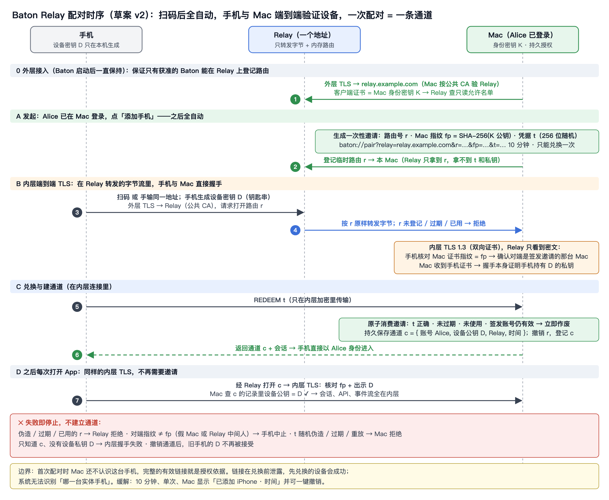

# Baton Relay 设计（已确认时序 · 实现基线）

> 2026-11-27 · 基线 Baton `ffc4bc6` · **时序已于 2026-11-27 经用户确认（「可以，干吧」）**，下方附录 A–H 为实现基线
>
> **本草案取代之前所有版本**，包括第 1–5 版和上一张使用人工核对码的时序图。旧内容可以在 Git 历史中查到。



*图：手机、Relay、Mac 三条生命线。0 为外层接入；A 为发起配对；B 为内层端到端 TLS；C 为兑换邀请并建立通道；D 为之后的每次登录。底部是失败分支和安全边界。图中数值均为虚构示例。*

## 一句话

Alice 在已登录的 Mac 上点「添加手机」。手机扫码或手动输入同一个 `baton://pair…` 地址后，**全程自动完成**：手机确认对端就是签发邀请的那台 Mac，Mac 确认手机持有自己的设备密钥并兑换一次性邀请，随后为「Alice 账号 + 这台手机」建立一条通道，手机直接登录。整个过程不需要核对码，不需要在 Mac 上再点一次，也不做真人验证。

另外保持不变的约定：
- 配对一次，就建立一条可以单独撤销的通道。
- Relay 地址按账号设置，长期保存。
- 所有用户共用一个 Relay 服务地址。
- 配对与路由都不依赖工作区 ID。

## 两层 TLS 各自保证什么

| 层 | 两端 | 保证什么 | 信任来源 |
| --- | --- | --- | --- |
| **外层** | Mac ↔ Relay；手机 ↔ Relay | 只有获准的 Baton 能在 Relay 上登记路由；客户端确实连到了真正的 Relay | Relay 使用公共 CA 证书；Mac 的身份密钥 K 在 Relay 的只读允许名单中 |
| **内层（端到端）** | 手机 ↔ Mac，在 Relay 转发的字节流中握手 | 手机确认对端就是签发邀请的那台 Mac；Mac 确认手机持有设备私钥 D；之后的邀请兑换、会话令牌和业务数据都在这一层加密传输 | Mac 的公钥指纹 `fp` 由二维码或手输地址带外传递；手机的设备公钥 D 在兑换时登记到通道记录中 |

内层握手采用标准 TLS 1.3 双向证书认证，双方都使用自签证书，靠指纹或通道记录来固定身份，不需要自行设计密码协议。Relay 只能看到路由号 `r` 或通道号 `c`、连接时间和流量大小，**看不到邀请凭据、会话令牌和业务内容**。

## 配对地址里有什么

```
baton://pair?v=1&relay=relay.example.com&fp=7Q4M…K2PX&r=Ab12Cd34…&t=Zx9…（256 位）
```

| 字段 | 作用 | Relay 是否知道 |
| --- | --- | --- |
| `relay` | Relay 服务地址 | 知道 |
| `r` | 临时路由号，用来找到这台 Mac，10 分钟后失效 | 知道 |
| `fp` | Mac 身份公钥的指纹，手机用它确认连上的是对的 Mac | 不需要知道 |
| `t` | 一次性邀请凭据，只在内层加密连接中提交 | **不知道** |

二维码和手动输入的地址是同一份**受信的带外信息**。手机凭它来认 Mac，Mac 凭它判断这次授权是否有效。

## 能挡住什么，挡不住什么

**能挡住：**
- 伪造、过期或已用过的路由号：Relay 直接拒绝。
- 假冒的 Mac 或 Relay 中间人：证书指纹与 `fp` 不符，手机中止连接。
- 随机伪造的 `t`、过期的 `t` 或重复使用的 `t`：Mac 拒绝。邀请在兑换时被原子删除，只能使用一次。
- 只知道通道号 `c`，却没有对应设备私钥：内层握手失败。
- 通道被撤销后，旧手机的设备密钥 D 不再被接受。

**挡不住（如实说明）：** 首次配对时，Mac 还不认识这台手机，**完整且仍然有效的链接本身就是授权依据**。如果链接在兑换之前泄露（比如截图被转发），两台新手机都拿着同一条原始链接，系统无法分辨哪一台才是 Alice 的，**先兑换的那台会成功**。系统不能识别指定的某台实体手机。

缓解措施：
- 链接 10 分钟内有效，且只能兑换一次。
- Alice 兑换失败时会提示「链接已被使用」。
- Mac 在配对成功后立即显示「已添加 iPhone · 时间」，并提供一键撤销。

## 谁保存什么

| 位置 | 内容 | 生命周期 |
| --- | --- | --- |
| Relay 内存 | `r → Mac` 和 `c → Mac` 的路由 | `r` 最长保留 10 分钟，或使用一次后失效；`c` 在 Relay 重启后清空，由 Mac 重连后重新登记 |
| Relay 只读文件 | 获准接入的 Baton 身份公钥名单 | 由运营者维护 |
| Mac 账号库 | 未兑换的邀请（只存 `t` 的摘要）；通道 `c = {账号, 设备公钥 D, Relay, 时间}`；账号的 Relay 设置 | 邀请在兑换或过期时删除；通道保留到撤销为止；更改 Relay 后，经旧 Relay 建立的通道失效 |
| 手机 | 设备私钥 D（存于钥匙串或 Keystore）、Relay 地址、`fp`、`c` | 撤销或退出时删除 |

## 关键假设与未实测部分

- **手机端需要在一条连接里再套一层 TLS（这是最大的实现风险）。** 外层 TLS 连 Relay，内层 TLS 再跑在外层连接转发的字节流上，这要求手机的原生传输模块 `baton-transport` 支持。iOS 的 Network.framework 和 Android 的 OkHttp/SSLEngine 理论上可以做到，但**尚未实测**。如果做不到，备选方案是在内层改用 Noise 协议的 IK 模式（同样是成熟协议，验证语义不变）。这一点需要先用原型验证。
- Mac 侧可以用 Node 的 `tls.TLSSocket` 包装转发流，然后在内层运行 HTTP/2。上一轮已在本机原型中验证外层 mTLS 加反向 HTTP/2 可以工作，但**内层嵌套尚未做原型**。
- 打包后的 Electron 环境下，TLS 行为未实测；手机遇到离线、链接已被使用时的提示，也需要在真机上确认。

## 实现分工

- **设计：** Claude Code 负责本文件。
- **实现：** Codex 负责全部代码、测试与集成，并统一管理 Git 提交和 PR。
- **约定变更：** 附录 C 的接口约定一旦变化，Codex 先回报，再由 Claude Code 同步更新本文。

---

图的源文件为 `docs/diagrams.mjs`（生成 SVG），用 `docs/render-png.sh` 渲染为 PNG。

---

## 附录：架构、模块、接口与交互（实现基线）

### A. 组件与职责

| 组件 | 职责 | 不负责 |
| --- | --- | --- |
| `relay/`（新建，独立 Node 服务） | 外层 TLS 终止；按允许名单接受 Baton；在内存中维护 `(fp, 路由号) → Baton 连接`；在手机连接与 Baton 之间原样转发字节 | 不解析内层数据，不保存邀请、令牌、账号或业务数据，不写任何文件 |
| `server/relay-identity.mjs`（新建） | Mac 身份密钥 K：生成并保存到 `controlRoot/relay-identity.pem`（权限 0600）；计算 `fp`；生成内层 TLS 服务端自签证书 | — |
| `server/relay-connector.mjs`（新建） | 取所有账号 Relay 设置去重后的集合，为每个 Relay 维持一条外层连接；登记和注销路由；对每条手机流执行内层 TLS 服务端握手，并把明文交给网关 | 不做授权判断（授权由网关负责） |
| `server/workspace-identity.mjs`（修改） | 新增三张表：账号 Relay 设置、邀请、通道；提供原子兑换和撤销 | — |
| `server/workspace-http.mjs`（修改） | 新增内层入口：按客户端证书和 Bearer 令牌双重认证；新增兑换路由；其余 API 和事件流沿用现有白名单 | 现有局域网、反向代理入口和登录行为保持不变 |
| `server/index.mjs`、`web/settings.mjs`（修改） | 账号设置中的「远程访问」入口、「添加手机」对话框，以及仅本机可用的管理接口 | — |
| `apps/mobile/modules/baton-transport`（修改） | 外层 TLS 连接 Relay → 打开路由 → 内层 TLS（固定 `fp`，出示设备证书）；为通道提供 request / stream / upload / download 能力 | — |
| `apps/mobile/src`（修改） | 登录页的「扫码」「输入配对地址」入口；`parsePairUri`；保存通道会话；会话失效处理 | — |

### B. 标识与密钥

| 名称 | 生成方 | 格式 | 保存位置 |
| --- | --- | --- | --- |
| K / `fp` | Mac 首次启用 Relay 时生成 | ECDSA P-256；`fp = base64url(SHA-256(SPKI))` | Mac `controlRoot/relay-identity.pem` |
| D | 手机在每次配对前新生成 | ECDSA P-256，自签名证书 | 钥匙串 / Keystore，不可导出 |
| `r` | Mac | 128 位随机数，base64url 编码 | Mac 邀请表；Relay 内存 |
| `t` | Mac | 256 位随机数，base64url 编码 | 只在二维码或地址中出现；Mac 只保存 `SHA-256(t)` |
| `c` | Mac 在兑换成功时生成 | 128 位随机数，base64url 编码 | Mac 通道表；Relay 内存；手机 |

Relay 的路由键是 `(fp, 路由号)`。手机打开路由时同时给出 `fp`，Relay 只会把它转给外层证书指纹等于 `fp` 的那条 Baton 连接。因此，即使有另一个获准的 Baton 抢先登记了相同的 `c`，请求也不会被转到它那里。即便 Relay 本身路由出错，内层 TLS 的 `fp` 校验仍会让连接失败。

### C. 接口约定（Codex 实现时以此为准，变更需回报）

**C1 配对地址**

```
baton://pair?v=1&relay=relay.example.com[:port]&fp=<base64url>&r=<base64url>&t=<base64url>
```

- 二维码内容与可复制文本完全相同。
- 手机端只接受 `v=1`，且必须同时包含四个字段。
- `relay` 只允许主机名加可选端口，不允许路径。

**C2 外层：Baton ↔ Relay**

- 连接方式：TLS 1.3 连接 `relay:443`，ALPN 为 `baton-relay-host/1`，客户端证书使用 K。
- Relay 校验：`fp(K)` 必须在只读文件 `allowed-hosts.txt` 中（每行一个 fp）。文件变更后自动重新读取；某个 fp 被移除时，立即断开对应连接。
- 连接建立后，**由 Relay 作为 HTTP/2 客户端，Baton 作为服务端**（反向 HTTP/2，已有原型验证）：
  - `GET /_relay/control`：一个长连接流。Baton 在响应体中写入 NDJSON 格式的路由变更：`{"op":"add","kind":"pair|channel","id":"…","expires":…}` 和 `{"op":"remove","id":"…"}`。连接建立后，Baton 先发送一份全量快照。
  - `POST /_relay/stream?id=<路由号>`：每条手机连接对应一个 HTTP/2 流，请求体和响应体就是双向原样字节，即内层 TLS 数据。
- Relay 限制：每个 Baton 最多 256 条并发流；pair 类路由在 `expires` 到期后，或第一条流结束后，自动删除。

**C3 外层：手机 ↔ Relay**

- 连接方式：TLS 1.3 连接 `relay:443`，ALPN 为 `http/1.1`，使用公共 CA 证书校验。
- 请求格式：
  ```
  GET /_baton/open?fp=<fp>&route=<r|c> HTTP/1.1
  Upgrade: baton-tunnel/1
  ```
- 响应：成功时返回 `101`，之后连接上传输原样字节。路由不存在、已过期或 fp 不匹配时，统一返回 `404 {"error":"route_unavailable"}`，不区分具体原因。

**C4 内层：手机 ↔ Mac**

- 连接方式：TLS 1.3 双向证书认证，ALPN 为 `http/1.1`。
  - 手机校验 `SHA-256(服务端 SPKI) == fp`，不使用 CA 链。
  - Mac 接受任意客户端证书，在应用层再做校验。
- 请求：
  - `POST /relay/redeem {t, label}`：仅允许在 pair 类路由上调用。成功返回 `{channel:c, token, user:{name}, workspace:{name}}`。
  - 其余请求走现有的 `/api/*` 和 `/api/workspace/events`，携带 `Authorization: Bearer <token>`。网关额外校验：令牌所属设备行的 `channel` 等于当前路由 `c`，且该设备行的设备公钥哈希等于本连接客户端证书的哈希。两项都满足才放行。

**C5 Mac 本机接口（仅限本机或已登录会话，只能操作本人）**

| 方法 | 路径 | 说明 |
| --- | --- | --- |
| GET | `/api/account/relay` | 返回 `{relay, status, fp, devices:[…]}` |
| PUT / DELETE | `/api/account/relay` | 设置或清除本人的 Relay；清除或更换会撤销本人经旧 Relay 建立的所有通道 |
| POST | `/api/account/relay/invites` | 返回 `{uri, qr, expiresAt}`；前提是该 Relay 已连接 |
| GET | `/api/account/relay/invites/:r` | 返回 `waiting / redeemed{label,at} / expired`，供对话框轮询 |
| DELETE | `/api/account/relay/devices/:id` | 撤销指定通道 |

### D. 邀请兑换与设备授权的一致性

- **数据表（`workspace-access.sqlite`）：**
  - `account_relays(member PK, relay, updated)`
  - `relay_invites(route PK, hash, member, relay, accountVersion, expires)`
  - `devices` 表新增列：`channel UNIQUE`、`deviceKeyHash`、`relay`
- **兑换在一个 `BEGIN IMMEDIATE` 事务内完成：**
  1. `DELETE FROM relay_invites WHERE route=? AND hash=? AND expires>? RETURNING …`
  2. 校验三项：签发账号仍存在；本机模式下凭据版本没有变化；`relay` 仍是该账号的当前设置。
  3. 生成 `c`，插入 `devices` 行（scope=`mobile`，记录 member、label、channel、deviceKeyHash、relay），并签发 token。
  4. 提交事务。提交成功后再向 Relay 发送 `remove r` 和 `add c`。

  因为第 1 步只会有一个请求删到这一行，**并发兑换只可能成功一次**；其余请求一律得到 `401 {"error":"invite_invalid"}`。凭据错误、已过期、已被使用，都返回这同一个错误。
- **兑换限流：** 每个路由号最多尝试 5 次，超过后整条邀请作废（防止有人在线猜 `t`，尽管 256 位凭据本身已无法猜中）。
- **失效规则：**

| 事件 | 结果 |
| --- | --- |
| 撤销某台设备 | 删除该设备行，发送 `remove c`，关闭该通道上的现有流 |
| 账号更换或清除 Relay | 撤销本人在旧 Relay 上的全部通道和未兑换的邀请 |
| 本机管理员重置凭据 | 现有逻辑已让所有会话失效，通道一并失效 |
| 设备闲置 30 天 | 沿用现有设备会话的过期策略 |

### E. 路由的登记、恢复与撤销

- **Baton 侧：**
  - 每次外层连接建立后，Baton 发送全量快照：所有未过期的邀请 `r`，以及所有有效通道 `c`。
  - 断线后按 1s、2s、4s… 退避重连，最长间隔 30s，并加入随机抖动。
  - Relay 重启或网络切换后，快照会重建全部路由，用户无需任何操作。
- **手机侧：** 打开通道时如果返回 `route_unavailable`，按「Mac 离线」处理，以 1→15s 的间隔重试（沿用现有事件流的重连节奏），**不清除登录状态**。只有内层返回 401 时，才判定「此设备已被移除」。
- **Relay 侧：** 某条 Baton 连接断开时，立即删除它登记的所有路由。

### F. 手机会话与缓存隔离

- 通道会话保存为 `SavedWorkspace{ origin: "baton-channel://<c>", relay, fp, channel: c, … }`，token 存入钥匙串。设备私钥 D 的句柄与 `c` 绑定。
- 现有的 `workspaceId(origin, pin)`、查询缓存键 `['ws', id]`、文件缓存键 `origin|key` 都以这个虚拟 origin 为基础，**不同通道之间天然隔离**。同一手机对同一账号配对两次，会得到两条独立的通道和两份独立的缓存。
- `createApiClient` 的调用方式不变。传输层识别到 `baton-channel://` 后，经通道发出请求，现有业务代码无需改动。
- 浏览器和 Mac 外部窗口**不经 Relay**，继续使用现有的局域网或反向代理入口。

### G. 关键界面状态

**Mac：设置 › 通用 › 账号 › 远程访问**

| 状态 | 显示 | 可用操作 |
| --- | --- | --- |
| 未设置 | Relay 地址输入框 | 保存 |
| 连接中 / 重连中 | 灰点，显示「第 N 次重试」 | — |
| 已连接 | 绿点，显示 Relay 地址 | 「添加手机」 |
| Relay 未允许此 Mac | 红点，显示本机 fp 并提供复制按钮，提示「请让 Relay 运营者把它加入名单」 | — |
| Relay 不可达 | 红点，显示系统错误 | — |
| 已配对设备 | 列表：名称 · 经 Relay · 最近使用时间 | 每台设备一个「移除」 |

**Mac：「添加手机」对话框**

| 状态 | 显示 | 可用操作 |
| --- | --- | --- |
| 等待手机 | 二维码、可复制的地址、10:00 倒计时 | — |
| 已添加 | 「已添加 iPhone 15 · 刚刚」 | 「不是我，移除」 |
| 已过期 | 过期提示 | 「重新生成」 |

**手机：登录页**

- 入口：「扫码」「输入配对地址」，与现有的「添加地址」（局域网或反向代理，账号密码登录）并列。
- 配对过程依次显示：正在连接 Relay → 正在验证 Mac → 正在登录 → 进入工作区。
- 错误提示：
  - 配对地址无效
  - 链接已过期或已被使用
  - 无法验证这台 Mac
  - 无法连接 Relay
  - Mac 当前离线

**手机：使用中**

- 实时标记沿用现有逻辑；Mac 离线时显示「工作空间暂时离线」，并自动重连。
- 设备被移除时，提示「此设备已被移除」，并返回登录页。

### H. 可观察的验收结果（用于测试报告和交互报告）

| 编号 | 操作 | 预期可观察结果 |
| --- | --- | --- |
| V1 | 用手机原生传输层（模拟器即可）经 Relay 与 Mac 完成内层 TLS | 握手成功；Relay 抓包或日志中只出现路由号和字节数 |
| V2 | 在 Mac 设置 Relay 并添加手机，手机扫码 | 不输入密码直接进入；Mac 对话框显示「已添加」 |
| V3 | 手机改为粘贴同一类地址（新邀请） | 结果与 V2 相同 |
| V4 | 同一邀请由两台设备并发兑换 | 恰好一台成功，另一台显示「链接已过期或已被使用」 |
| V5 | 伪造 `t`、使用过期邀请、把 `fp` 改成别的值 | 伪造和过期邀请被拒绝；改动 `fp` 后在「验证 Mac」阶段失败；均不产生设备行 |
| V6 | 两台手机各自配对后，撤销其中一台 | 被撤销的手机显示「已被移除」；另一台继续正常使用 |
| V7 | 两个 Baton 共用一个 Relay，各配对一台手机 | 两边互不影响；把 A 的 `c` 配上 B 的 `fp` 无法打开通道 |
| V8 | 重启 Relay | 30 秒内两条通道自动恢复，手机无需重新配对；Relay 不写入任何文件 |
| V9 | 账号更换 Relay | 该账号在旧 Relay 上的通道失效，同一工作区其他账号不受影响 |
| V10 | 回归现有入口 | 局域网和反向代理的账号密码登录、浏览器访问均不受影响 |
| V11 | 检查日志 | Relay 和 Mac 日志中不出现 `t`、token 或 Cookie |

交互报告以真实操作为依据，截图和观察记录需注明来源是真机、模拟器还是协议测试。

**实现风险（与正文一致）：** 手机端在外层 TLS 之上再嵌套内层 TLS，需要先用 V1 验证。如果 iOS 或 Android 原生栈无法实现，内层改用 Noise IK，认证语义不变，接口 C4 改为「Noise 之上传输 HTTP/1.1」。
